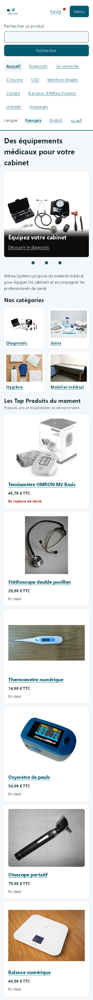
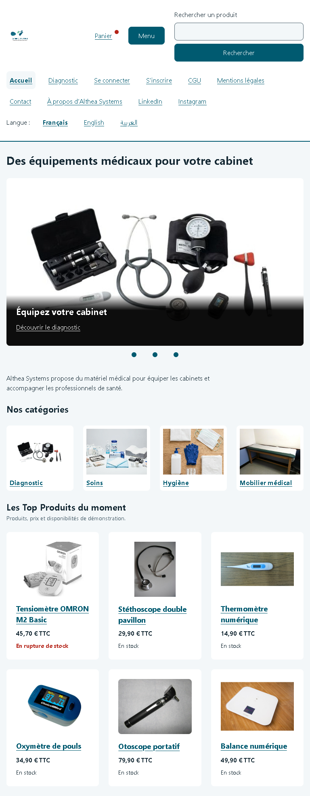
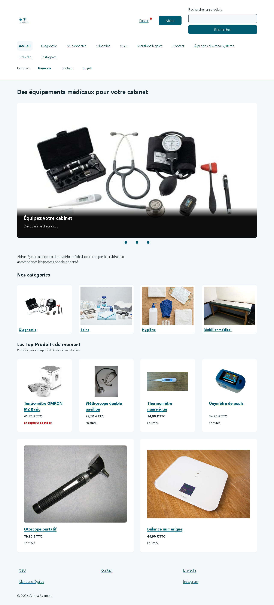
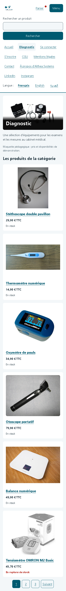
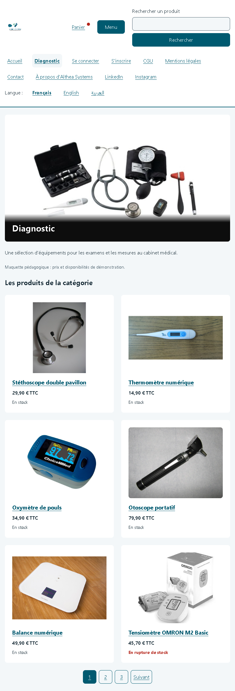
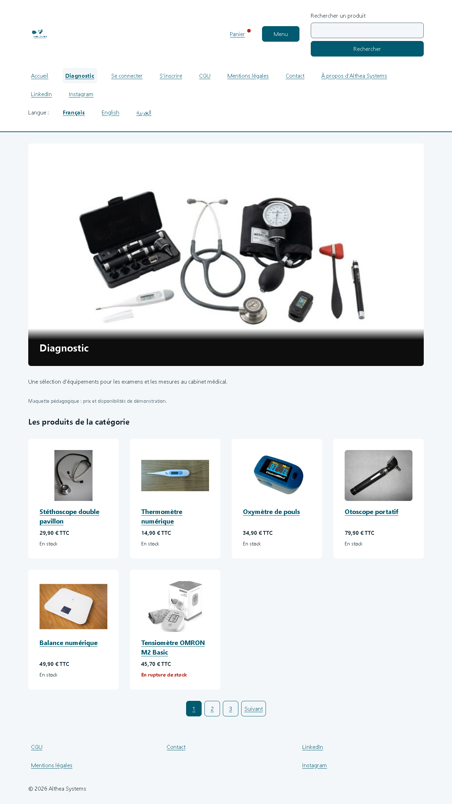
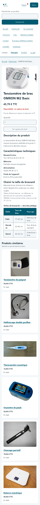
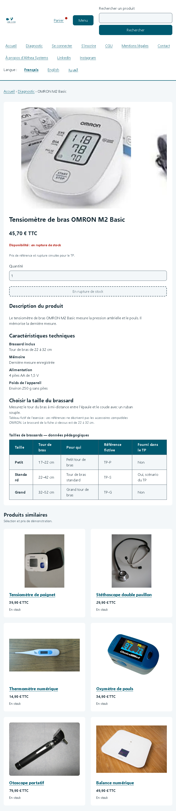
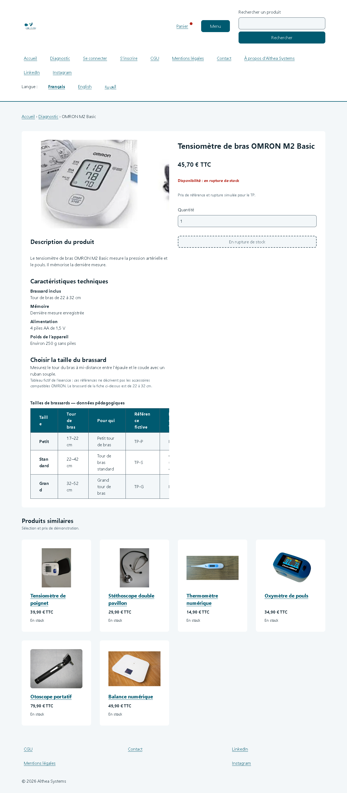
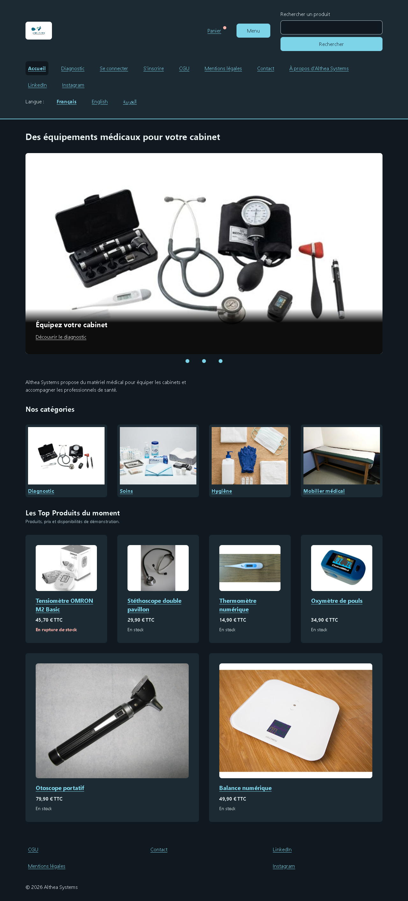

# Althea Systems

Maquette pédagogique de vente de matériel médical, réalisée en HTML et CSS pour les TP Jour 1 et Jour 2.
Le travail personnel est conservé sur **`Branch-Aymen_aitsaid`**, sans fusion dans le `main` du camarade.

## Pages réalisées

| Fichier | Page |
|---|---|
| `index.html` | Accueil : trois slides, catégories et Top Produits |
| `categorie.html` | Diagnostic : bandeau, six produits et pagination |
| `produit.html` | OMRON M2 Basic : galerie, informations, tableau pédagogique et impression |
| `recherche.html` | Filtres, tri, résultats et pagination statiques |
| `connexion.html` | Formulaire de connexion en POST |
| `inscription.html` | Formulaire d’inscription en POST |

## Ouvrir le site

Depuis la racine du projet, lancer un serveur HTTP, puis ouvrir son adresse :

```bash
python -m http.server 8000
```

Adresse : `http://localhost:8000/index.html`. Python doit être installé pour cette commande.
Un serveur HTTP sans injection de JavaScript permet de tester la CSP sans bruit de rechargement automatique.
L’extension Live Server peut aussi afficher le site, mais son script de rechargement peut être refusé par la CSP.

## Organisation et choix techniques

- HTML : structure des six pages ; aucune logique JavaScript applicative au Jour 2.
- `css/variables.css` : palette, tailles, espacements et mode sombre automatique.
- `css/style.css` : mise en page mobile d’abord, Flexbox, Grid, composants partagés et impression.
- `img/` : fichiers locaux ; versions adaptées au carrousel et à la galerie.
- `docs/` : analyse, audit historique, recette Jour 2, sécurité, sources et preuves.

Les couleurs existantes sont conservées. Les espacements augmentent aux paliers de 48rem et 64rem.
Les mêmes classes servent aux cartes de plusieurs pages. Le défilement et les pastilles utilisent
les fonctions natives du navigateur et du CSS ; les transitions respectent la préférence de mouvement réduit.

## Responsive : corrections et preuves

Les corrections finales portent sur les images absentes, le texte blanc sur les photos,
`color-scheme` pour les contrôles natifs et les lignes alternées du tableau.
Aucun débordement détecté à **320, 360, 768 et 1280 pixels**, dans les modes clair et sombre,
sur les six pages. Le reflow à 200 % a été contrôlé par une zone CSS équivalente ; la méthode
exacte et les limites sont dans [la recette](docs/responsive.md).

### Captures finales

| Page | Téléphone, 360 px | Tablette, 768 px | Ordinateur, 1280 px |
|---|---|---|---|
| Accueil |  |  |  |
| Catégorie |  |  |  |
| Produit |  |  |  |



### Résultats du Jour 2 — 3 novembre 2026

| Page | Accessibilité | Bonnes pratiques | SEO | Erreurs HTML |
|---|---|---|---|---|
| Accueil | 100/100 | 100/100 | 100/100 | 0 |
| Catégorie | 100/100 | 100/100 | 100/100 | 0 |
| Produit | 100/100 | 100/100 | 100/100 | 0 |
| Recherche | 100/100 | 100/100 | 100/100 | 0 |
| Connexion | 100/100 | 100/100 | 100/100 | 0 |
| Inscription | 100/100 | 100/100 | 100/100 | 0 |

Rapports Lighthouse obtenus sous Chrome, configuration mobile. La catégorie Performance n’a pas été mesurée.
Les deux CSS n’ont aucune erreur de syntaxe ; validation CSS W3C sans erreur, profil CSS3 + SVG
pour `style.css`, contrôlé par lots complets de règles à cause de la limite du service.
Les réponses brutes et avertissements sont archivés dans [les rapports](docs/rapports/).

Les tests axe ne signalent aucune violation des règles WCAG A/AA testées, en clair comme en sombre.
Ils ne remplacent pas une évaluation humaine complète. Les anciens scores du Jour 1 sont conservés
dans `docs/audit.md` et ne sont pas présentés comme des mesures du Jour 2.

## Documents utiles

- [Suivi des 31 étapes](docs/etapes-jour2.md).
- [Recette responsive et limites des tests](docs/responsive.md).
- [Sécurité : protections et limites](docs/securite.md).
- [Contrastes calculés](docs/contrastes.md).
- [Sources et licences des photographies](docs/sources-images.md).
- [Fiche produit imprimée : deux pages A4](docs/rapports/produit-impression.pdf).

## Limites et demandes particulières

- Le champ de filtre « Description » a été retiré à la demande de l’auteur, malgré sa présence à l’étape 25.
- Les commentaires de code ont été retirés à sa demande ; les ratios de contraste sont donc documentés séparément.
- Recherche, tris, pagination, menu interactif, comptes, panier et achat : maquette, sans traitement applicatif.
- POST ne chiffre pas les données : une vraie authentification nécessite HTTPS et des contrôles serveur.
- La confirmation des mots de passe sera comparée en JavaScript puis sur le serveur au développement de la logique.
- Les traductions et les pages annexes non demandées au Jour 2 restent des destinations prévues.
- Les produits/prix et la rupture sont des données d’exercice ; le tableau des brassards est explicitement fictif.
- Les photos génériques ne prouvent pas les caractéristiques d’un article ; la galerie OMRON utilise des recadrages.
- L’adresse Open Graph `althea.example` reste une adresse de démonstration.

## Version à remettre

Le dépôt partagé possède déjà une étiquette `jour-2`. Elle ne doit pas être déplacée ni remplacée.
La version personnelle finalisée reste sur `Branch-Aymen_aitsaid` ; une étiquette distincte
`jour-2-Aymen-aitsaid` identifie ce rendu sans toucher à `main` ni à l’étiquette commune.
Le lien à remettre est celui de la branche personnelle, pas une demande de fusion.
