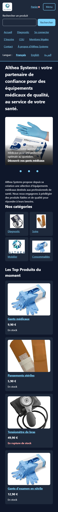
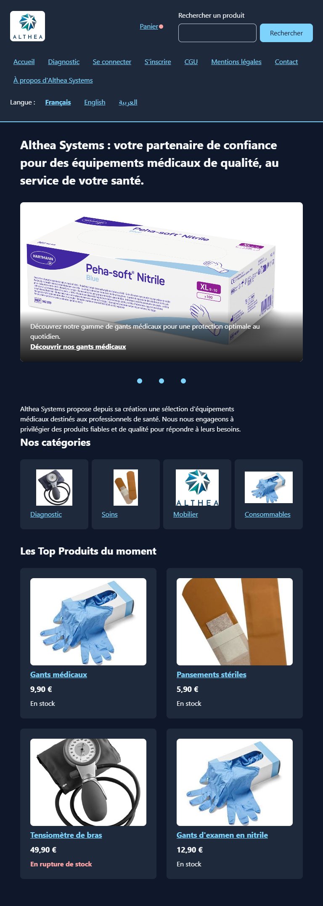
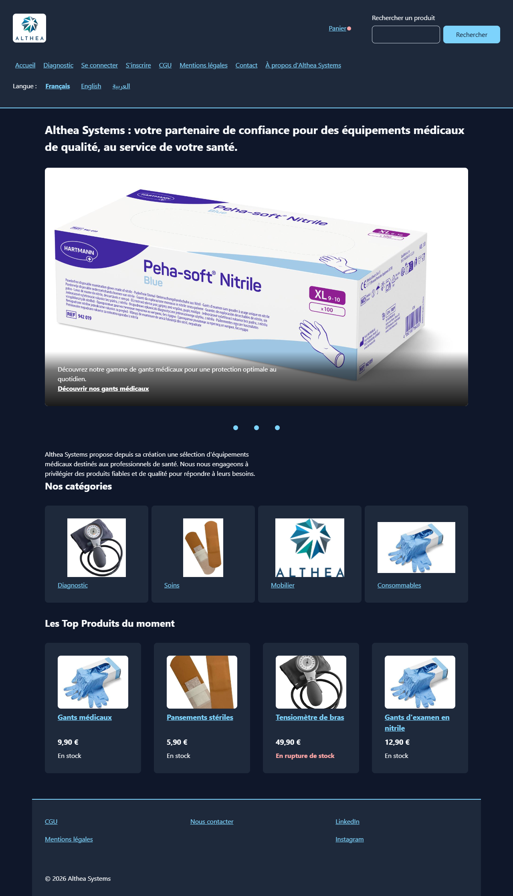
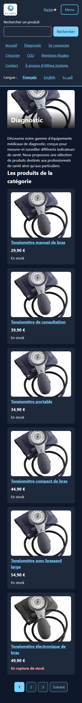
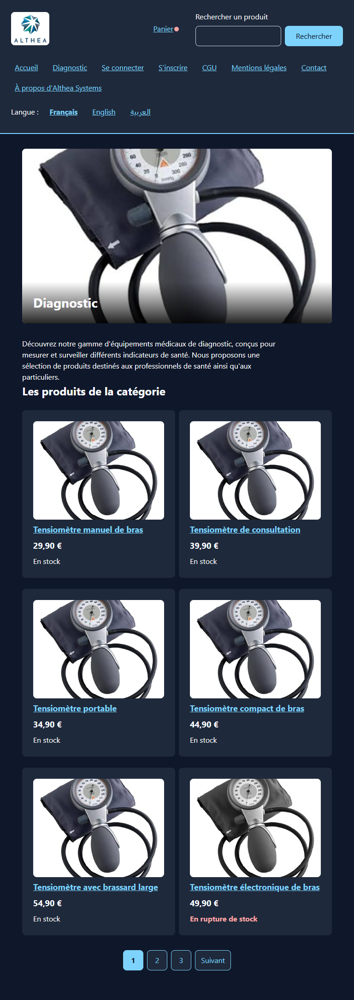
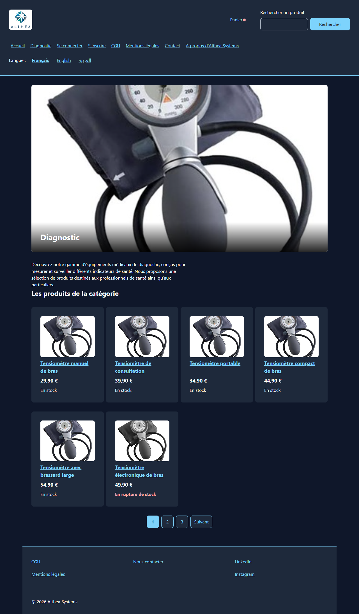
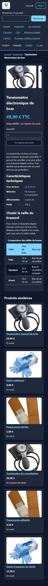
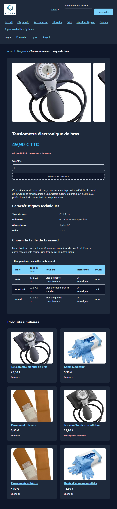
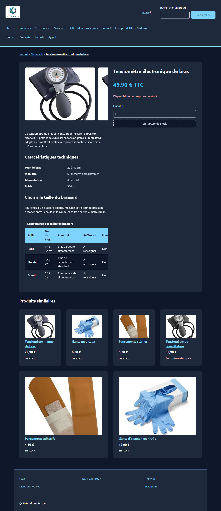
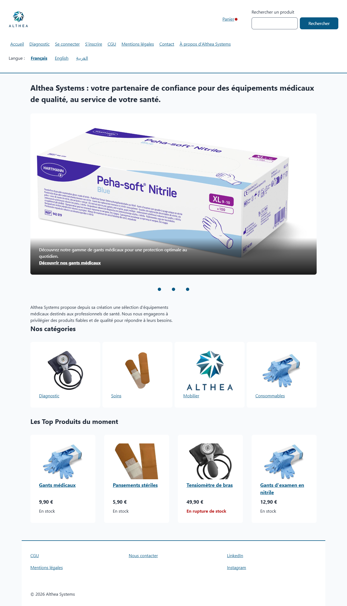

# Althea Systems

## Présentation du projet

Althea Systems est un site de présentation et de vente d'équipements médicaux destiné aux particuliers et aux professionnels de santé.

Ce projet a été réalisé dans le cadre de trois travaux pratiques :

- **Jour 1 — Structurer et styliser** : création des pages HTML, structure sémantique et premiers styles CSS.
- **Jour 2 — Responsive et mise en page** : adaptation aux écrans, accessibilité, sécurité et amélioration de la présentation.
- **Jour 3 — JavaScript et DOM** : développement des fonctionnalités interactives, du catalogue, de la recherche, des avis clients et du panier.

L'objectif est de développer un site multipage en HTML5, CSS3 et JavaScript ES6, responsive, accessible et respectant les bonnes pratiques de sécurité et de développement.

Il s'agit d'un projet pédagogique front-end. Les interactions commerciales sont simulées dans le navigateur, sans paiement ni commande réelle.

---

## Technologies utilisées

| Technologie | Utilisation |
|---|---|
| HTML5 | Structure sémantique des pages |
| CSS3 | Mise en forme et responsive design |
| Flexbox | Organisation des éléments |
| CSS Grid | Grilles et mise en page |
| Media Queries | Adaptation aux différents écrans |
| CSS Scroll Snap | Carrousels et galeries |
| JavaScript ES6 | Fonctionnalités et interactions dynamiques |
| DOM API | Création et modification des éléments HTML |
| Modules JavaScript | Organisation et réutilisation du code |
| Fetch API | Chargement des avis clients |
| JSON | Stockage et échange de données structurées |
| localStorage | Sauvegarde du panier dans le navigateur |
| Git | Gestion des versions |
| GitHub | Hébergement et collaboration |
| Lighthouse | Audits de performance et d'accessibilité |
| W3C Validator | Validation HTML et CSS |

Le projet fonctionne sans framework JavaScript et sans système de compilation.

---

## Pages réalisées

### Accueil — index.html

- En-tête avec logo et navigation
- Formulaire de recherche rapide
- Choix de langue
- Menu responsive utilisable au clavier
- Carrousel de trois diapositives
- Boutons Précédent et Suivant
- Pastilles indiquant la diapositive active
- Présentation de l'entreprise
- Quatre catégories de produits
- Produits du moment
- Pied de page

Le carrousel est rendu interactif avec JavaScript.

Le menu peut être ouvert au clavier et fermé avec la touche Échap.

### Catégorie — categorie.html

- Bandeau avec image et titre superposé
- Présentation de la catégorie Diagnostic
- Catalogue de sept produits
- Cartes produits générées en JavaScript
- Grille responsive
- Tri recommandé
- Tri par prix croissant
- Tri par prix décroissant
- Filtre « Disponibles seulement »
- Affichage du nombre de produits
- Produits en rupture de stock placés en dernier
- Boutons désactivés pour les produits épuisés
- Ajout au panier

Le catalogue utilise les données du fichier `js/produits.js`.

Un septième produit contenant du HTML est utilisé pour tester la sécurité contre les injections XSS.

La pagination HTML initiale est conservée comme élément de maquette, mais n'est pas utilisée par le catalogue dynamique.

### Produit — produit.html

- Fil d'Ariane
- Galerie de photographies responsive
- Nom et prix du produit actualisés avec JavaScript
- Identification du produit depuis son URL
- Affichage de la disponibilité
- Formulaire d'achat
- Vérification des quantités entre 1 et 10
- Désactivation de l'achat en cas de rupture
- Message de confirmation après ajout au panier
- Description et caractéristiques techniques
- Tableau comparatif des tailles de brassard
- Produits similaires
- Avis clients chargés depuis un fichier JSON
- Calcul automatique de la note moyenne
- Version imprimable

La fiche récupère l'identifiant du produit dans l'adresse.

Exemple :

`produit.html?id=tensiometre-consultation`

Le nom, le prix et la disponibilité sont récupérés depuis `produits.js`.

Certaines images et caractéristiques techniques restent des données de démonstration communes aux différentes fiches.

### Recherche — recherche.html

- Recherche rapide depuis l'en-tête
- Recherche avancée par nom
- Normalisation des accents et majuscules
- Filtre par prix minimum
- Filtre par prix maximum
- Filtre de disponibilité
- Tri recommandé
- Tri par prix croissant
- Tri par prix décroissant
- Affichage du nombre de résultats
- Message lorsqu'aucun produit n'est trouvé
- Conservation des paramètres dans l'URL
- Conservation des filtres après rechargement
- Ajout au panier depuis les résultats

Les résultats sont générés automatiquement avec JavaScript.

Le formulaire conserve les champs de recherche par description, caractéristique et catégorie prévus dans la maquette.

Ces derniers ne disposent pas encore d'une logique de filtrage, car les objets du catalogue ne contiennent pas les informations correspondantes.

L'ancienne pagination statique n'est plus utilisée.

### Panier — panier.html

La page Panier a été développée au Jour 3.

Fonctionnalités :

- Affichage des articles ajoutés
- Affichage du nom et du prix des produits
- Modification des quantités
- Suppression des articles
- Calcul du sous-total de chaque ligne
- Calcul du total TTC
- Message lorsque le panier est vide
- Actualisation du compteur dans l'en-tête
- Sauvegarde avec localStorage
- Conservation des articles après actualisation
- Synchronisation entre plusieurs onglets

Les produits et leurs quantités sont conservés localement dans le navigateur.

### Connexion — connexion.html

- Adresse e-mail
- Mot de passe
- Validation HTML des champs
- Messages d'erreur
- Lien vers l'inscription

Le formulaire est préparé pour une future intégration avec un serveur d'authentification.

Aucune authentification réelle n'est encore disponible.

### Inscription — inscription.html

- Prénom et nom
- Adresse e-mail
- Mot de passe de 12 caractères minimum
- Confirmation du mot de passe
- Acceptation obligatoire des CGU
- Validation HTML des champs

La création effective d'un compte nécessitera un serveur applicatif.

---

## JavaScript — Jour 3

### Organisation des fichiers

Le code JavaScript est organisé en modules ES6 afin de séparer les responsabilités et de faciliter la maintenance.

Les fichiers sont situés dans `Althea-front/js/`.

| Fichier | Rôle |
|---|---|
| `main.js` | Point d'entrée, initialise les fonctionnalités des pages |
| `produits.js` | Contient les données des produits et leur recherche par identifiant |
| `outils.js` | Fonctions utilitaires, notamment le formatage des prix |
| `tri.js` | Tri recommandé et tri par prix |
| `catalogue.js` | Création et affichage des cartes produits |
| `recherche.js` | Recherche, normalisation et filtres |
| `fiche.js` | Affichage dynamique de la fiche et gestion de l'achat |
| `avis.js` | Chargement et affichage sécurisé des avis clients |
| `panier.js` | Gestion des articles, quantités, suppressions et sauvegarde |
| `vue-panier.js` | Affichage du panier et gestion des interactions |
| `icone-panier.js` | Actualisation du compteur et de l'indicateur du panier |
| `menu.js` | Gestion du menu responsive et du clavier |
| `carrousel.js` | Navigation et gestion des pastilles actives |
| `tests.js` | Tests automatiques des fonctions JavaScript |

### Fonctionnalités JavaScript utilisées

Le projet utilise notamment :

- `const` et `let`
- Fonctions fléchées
- Déstructuration des objets
- Template literals
- Modules `import` et `export`
- `map()`, `filter()`, `find()` et `reduce()`
- Copie de tableaux avec `[...liste]`
- `URLSearchParams`
- `createElement()`
- `textContent`
- `addEventListener()`
- `async` et `await`
- `fetch()`
- `JSON.parse()` et `JSON.stringify()`
- `localStorage`
- Événement `storage`
- `try/catch`

Ces fonctionnalités permettent de développer une interface dynamique sans framework.

---

## Catalogue et tri des produits

### Données des produits

Les produits sont définis dans `js/produits.js`.

Chaque produit possède :

| Propriété | Description |
|---|---|
| `id` | Identifiant unique |
| `nom` | Nom du produit |
| `prix` | Prix unitaire en euros |
| `stock` | Quantité disponible |
| `prioritaire` | Indique si le produit est mis en avant |

### Règle du tri recommandé

Le catalogue applique l'ordre suivant :

1. Produits prioritaires disponibles
2. Autres produits disponibles
3. Produits en rupture de stock

Les produits épuisés restent toujours placés à la fin, même lorsqu'ils sont prioritaires.

Pour le tri par prix, les produits disponibles sont classés par prix croissant ou décroissant, puis viennent les produits épuisés.

La fonction de tri utilise une copie du tableau pour préserver les données d'origine.

### Gestion des ruptures de stock

Lorsqu'un produit possède un stock égal à zéro :

- Une indication de rupture est affichée.
- Le bouton d'ajout au panier est désactivé.
- La fonction d'ajout refuse également ce produit.

Cette vérification empêche de dépendre uniquement des restrictions de l'interface.

---

## Recherche et filtres

La recherche utilise `URLSearchParams` pour récupérer les valeurs présentes dans l'adresse.

Exemple :

`recherche.html?q=tensiometre`

La fonction `normaliser()` permet de rechercher un produit sans tenir compte des majuscules, des accents et des espaces inutiles autour du texte.

Ainsi, les recherches `TENSIOMETRE` et `tensiometre` retrouvent les produits contenant le mot « Tensiomètre ».

Les valeurs numériques provenant de l'URL sont vérifiées avant utilisation.

Un prix négatif, une valeur non numérique ou un tri inconnu ne doivent pas provoquer d'erreur JavaScript.

Les produits correspondants sont affichés automatiquement avec `afficherCatalogue()`.

---

## Fiche produit et achat

Le module `fiche.js` récupère l'identifiant du produit sélectionné dans l'URL.

Il met à jour :

- Le nom du produit
- Le prix
- La disponibilité
- Le bouton d'achat
- Le titre de l'onglet
- Le fil d'Ariane lorsque l'élément correspondant est présent

Le formulaire d'achat vérifie que la quantité choisie est un entier compris entre 1 et 10.

Les valeurs incorrectes sont refusées avec un message explicite.

Un produit épuisé ne peut pas être ajouté.

Après un ajout réussi, le compteur du panier est actualisé.

---

## Avis clients

Les avis clients sont enregistrés dans :

`Althea-front/data/avis.json`

Le module `avis.js` utilise `fetch()` et `async/await` pour charger le fichier.

Les données reçues sont vérifiées avant affichage.

Un avis valide doit :

- Correspondre au produit affiché
- Posséder une note entière entre 1 et 5
- Contenir un nom d'auteur
- Contenir un commentaire sous forme de texte

Les avis invalides sont ignorés.

La moyenne des notes est calculée automatiquement avec `reduce()`.

Les avis utilisés pendant le TP sont fictifs et contiennent volontairement un exemple de code HTML malveillant pour vérifier la protection contre les injections XSS.

Si le fichier JSON ne peut pas être chargé, un message informe l'utilisateur que les avis sont indisponibles.

---

## Gestion du panier

Le panier est géré dans `js/panier.js`.

Les principales fonctions permettent :

- D'ajouter un produit
- De modifier sa quantité
- De supprimer une ligne
- De compter les articles
- De calculer le total

La page Panier est construite dynamiquement avec le module `vue-panier.js`.

Les sous-totaux sont calculés à partir du prix et de la quantité de chaque article.

### Sauvegarde avec localStorage

Le panier est sauvegardé dans le navigateur avec la clé :

`althea-panier`

La sauvegarde utilise `JSON.stringify()`.

Le chargement utilise `JSON.parse()` et `try/catch`.

Seuls les identifiants et les quantités des produits sont conservés.

Les prix sont toujours récupérés depuis `produits.js`.

Les données sauvegardées sont vérifiées avant utilisation :

- Produit existant dans le catalogue
- Quantité entière
- Quantité comprise entre 1 et 99
- Absence de doublon d'identifiant

Les lignes invalides sont ignorées.

### Synchronisation entre plusieurs onglets

L'événement `storage` permet de détecter les modifications du panier effectuées depuis un autre onglet du même site.

La fonction `recharger()` relit les données enregistrées.

Elle utilise `splice()` pour remplacer le contenu du tableau sans modifier sa référence.

Le compteur, les articles et le total du panier sont ensuite actualisés.

Les changements deviennent visibles entre deux onglets sans rechargement manuel.

---

## Responsive

Le site a été développé selon une approche Mobile First.

La mise en page utilise Flexbox et CSS Grid pour s'adapter aux différentes largeurs d'écran.

Les principaux formats étudiés sont :

- 320 px : petits téléphones
- 360 px : téléphones
- 768 px : tablettes
- 1 280 px : ordinateurs

### Captures des pages

| Page | 360 px | 768 px | 1 280 px |
|---|---|---|---|
| Accueil |  |  |  |
| Catégorie |  |  |  |
| Produit |  |  |  |

### Mode sombre

Le site propose un mode sombre automatique grâce à la media query `prefers-color-scheme`.

Les couleurs sont centralisées dans `css/variables.css`, ce qui permet de changer le thème sans modifier la structure HTML.

Les contrastes et la lisibilité des éléments sont pris en compte dans les modes clair et sombre.



---

## Accessibilité

Les améliorations suivantes ont été réalisées :

- HTML sémantique
- Hiérarchie des titres
- Textes alternatifs pour les images
- Navigation au clavier
- Lien d'évitement
- Focus visible
- Zones interactives adaptées au tactile
- Labels associés aux champs
- Messages d'erreur explicites
- Respect de `prefers-reduced-motion`
- Contrastes adaptés aux modes clair et sombre
- Tableau accessible aux lecteurs d'écran
- Gestion de `aria-expanded` pour le menu
- Fermeture du menu avec Échap
- Messages dynamiques avec `aria-live`
- Boutons désactivés pour les produits épuisés
- Libellés accessibles pour les boutons de suppression
- Gestion du focus après suppression d'un produit
- Indication de la diapositive active du carrousel

Les fonctionnalités interactives sont prévues pour être utilisables au clavier.

Une largeur de 360 px fait partie des formats de test de la recette finale.

---

## Résultats Lighthouse

Les tests Lighthouse ont été réalisés en local sur les six pages initiales du projet à la fin du Jour 2.

| Page | Performance | Accessibilité | Bonnes pratiques | SEO |
|---|---:|---:|---:|---:|
| Accueil | 100 | 100 | 100 | 100 |
| Catégorie | 100 | 100 | 100 | 100 |
| Produit | 77 | 100 | 100 | 100 |
| Recherche | 100 | 100 | 100 | 100 |
| Connexion | 100 | 100 | 100 | 100 |
| Inscription | 100 | 100 | 100 | 100 |

Toutes les pages auditées avaient obtenu 100/100 en accessibilité.

L'objectif du TP, fixé à 90/100 minimum, était donc atteint sur les six pages.

Ces résultats correspondent aux audits du Jour 2, avant l'intégration complète du JavaScript.

---

## Validation du code

### Validation HTML

Les six pages initiales ont été vérifiées avec Nu Html Checker.

Résultat obtenu : aucune erreur HTML.

Des avertissements CSP ont été observés lors du téléversement des fichiers HTML.

Ils concernaient notamment les feuilles CSS et les images locales.

### Validation CSS

Les deux fichiers CSS ont été contrôlés avec le validateur W3C.

| Fichier | Erreurs | Avertissements |
|---|---:|---:|
| `css/variables.css` | 0 | 0 |
| `css/style.css` | 0 | 0 |

Ces validations ont été effectuées pendant le Jour 2.

Les tests et corrections sont détaillés dans :

`Althea-front/docs/responsive.md`

---

## Tests JavaScript — Jour 3

### Tests automatiques

Le fichier `js/tests.js` contient dix tests automatiques utilisant `console.assert()`.

Ils vérifient :

1. Le formatage d'un prix décimal
2. Le formatage d'un prix entier
3. Le placement des produits épuisés à la fin
4. La priorité d'un produit disponible
5. Le placement d'un produit prioritaire épuisé
6. L'absence de modification du tableau d'origine
7. Le tri par prix avec les produits épuisés à la fin
8. Le retour au tri recommandé si le choix est inconnu
9. La normalisation du texte de recherche
10. Le filtrage par prix maximum

Pour lancer les tests, ouvrir :

`http://localhost:8000/categorie.html?tests`

Puis consulter la console des outils de développement du navigateur.

Résultat attendu :

`Tests : 10 / 10 réussis`

### Tests fonctionnels

La recette finale prévoit la vérification des fonctionnalités suivantes :

- Ouverture des pages sans erreur JavaScript ou CSP
- Tris et filtres du catalogue
- Protection contre les injections HTML
- Menu responsive au clavier
- Navigation du carrousel
- Recherche sans accent
- Affichage des avis clients
- Validation des quantités d'achat
- Calcul des sous-totaux et du total du panier
- Suppression des articles
- Sauvegarde dans localStorage
- Synchronisation entre deux onglets
- Affichage sur téléphone à 360 px
- Lisibilité en mode sombre

Les résultats sont documentés dans :

`Althea-front/docs/tests-js.md`

### Débogage JavaScript

Le débogueur Chrome a été utilisé pour observer le comportement des fonctions du panier.

Des points d'arrêt ont permis de suivre :

- La variable `ligne` lors de l'ajout d'un produit
- La création d'une ligne lors du premier ajout
- L'augmentation de la quantité lors d'un deuxième ajout
- Le calcul du total avec `reduce()`

Les points d'arrêt utilisés pour les tests doivent être supprimés avant le rendu final.

---

## Problèmes rencontrés et corrections

### Jours 1 et 2

| Problème | Correction |
|---|---|
| Images trop grandes sur la page Catégorie | Bandeau au format 16/9 avec `object-fit: cover` |
| Produits affichés verticalement sur ordinateur | Grille CSS responsive |
| Organisation de la fiche produit sur ordinateur | Grid avec `grid-template-areas` |
| Avertissement HTML sur la zone du tableau | Remplacement par un `div` avec `role="region"` |
| Tableau trop large sur téléphone | Défilement horizontal limité au tableau |
| Adaptation des couleurs au mode sombre | Variables CSS spécifiques au thème sombre |

### Jour 3

| Problème | Correction |
|---|---|
| Erreur d'import de `mettreAJourIcone` | Correction de l'export du module |
| Erreur JavaScript dans le carrousel | Correction d'une variable non définie |
| Pastilles du carrousel affichées en double | Correction de la génération des indicateurs |
| Recherche n'affichant pas les produits | Correction des imports et de l'initialisation JavaScript |
| Recherche avancée ne récupérant pas le nom | Lecture du paramètre `nom` dans l'URL |
| Les liens des produits ouvraient la même fiche | Transmission de l'identifiant dans l'adresse |
| Nom et prix de la fiche non actualisés | Correction des sélecteurs DOM |
| Panier réinitialisé entre les pages | Sauvegarde avec localStorage |
| Produits de test réapparaissant après suppression | Suppression de l'ajout automatique des produits |
| Erreur d'export de la variable panier | Ajout de `export const panier = charger()` |
| Panier non synchronisé entre les onglets | Utilisation de l'événement storage |
| Conflits Git lors d'une Pull Request | Résolution manuelle des conflits |

Ces corrections ont été suivies de tests pour vérifier que les fonctionnalités précédentes restaient opérationnelles.

---

## Sécurité

Le projet intègre plusieurs mesures de sécurité :

- Liens externes en HTTPS
- Protection des liens ouvrant un nouvel onglet
- Formulaires de recherche utilisant GET
- Formulaires de compte préparés avec POST
- Politique Content Security Policy (CSP)
- Politique Referrer
- Fichier `.gitignore`
- Vérification des paramètres provenant des URL
- Validation des quantités
- Vérification des données de localStorage
- Affichage sécurisé avec `textContent`

### Protection contre les injections XSS

Les noms de produits, les résultats de recherche et les avis clients sont affichés avec `textContent`.

Cette méthode permet d'afficher le texte sans interpréter les éventuelles balises HTML.

Des données de test contenant des balises HTML ont été utilisées pour vérifier le comportement du site.

La création d'éléments avec `document.createElement()` permet également de contrôler la structure générée.

Les données non fiables ne doivent pas être insérées directement dans `innerHTML`.

### Content Security Policy

La CSP limite les sources de contenu autorisées.

Les tests du Jour 2 avaient confirmé le blocage des styles intégrés non autorisés.

Les protections et leurs limites sont détaillées dans :

`Althea-front/docs/securite.md`

### Limites de sécurité

Le site étant un prototype front-end, les vérifications JavaScript sont effectuées côté navigateur.

Une application commerciale réelle nécessiterait également des contrôles côté serveur pour les prix, les stocks, les comptes et les paiements.

---

## Version imprimable

La fiche produit dispose d'une mise en page spécifique à l'impression.

Les menus, formulaires d'achat et éléments inutiles sont masqués.

La version imprimable conserve :

- Le nom et le prix du produit
- Une photographie
- La description
- Les caractéristiques techniques
- Le tableau des tailles

L'aperçu avant impression tenait sur une page A4 dans les conditions testées au Jour 2.

---

## Comment ouvrir le site

### Prérequis

Le projet nécessite :

- Un navigateur moderne compatible avec JavaScript ES6
- Python 3 ou un serveur HTTP local équivalent

Depuis le Jour 3, le site doit être exécuté depuis un serveur local pour permettre le chargement des modules JavaScript et des avis avec `fetch()`.

L'ouverture directe des fichiers HTML avec `file://` peut provoquer des restrictions du navigateur.

### Méthode recommandée : serveur Python

1. Télécharger ou cloner le dépôt GitHub.
2. Ouvrir un terminal dans le dossier `Althea-front`.
3. Exécuter la commande :

```bash
python -m http.server 8000
```

4. Ouvrir le navigateur à l'adresse :

`http://localhost:8000/index.html`

### Accès aux pages

| Page | Adresse |
|---|---|
| Accueil | http://localhost:8000/index.html |
| Catégorie | http://localhost:8000/categorie.html |
| Produit | http://localhost:8000/produit.html?id=tensiometre-consultation |
| Recherche | http://localhost:8000/recherche.html |
| Connexion | http://localhost:8000/connexion.html |
| Inscription | http://localhost:8000/inscription.html |
| Panier | http://localhost:8000/panier.html |
| Tests JavaScript | http://localhost:8000/categorie.html?tests |

---

## Limites du projet

Le site est un prototype pédagogique.

Certaines fonctionnalités restent à développer :

- Authentification et création de comptes réels
- Backend et base de données
- Paiement et validation de commande
- Gestion des stocks côté serveur
- Pagination dynamique
- Recherche par description et caractéristiques
- Filtrage fonctionnel par catégorie
- Changement effectif de langue
- Défilement automatique du carrousel
- Données techniques propres à chaque produit
- Avis clients provenant d'une base de données
- Synchronisation du panier entre différents appareils

Le panier actuel est enregistré dans le navigateur utilisé.

Les produits, les illustrations et les avis sont des données de démonstration.

Une version future pourrait intégrer une API, une base de données et un système de paiement.

---

## Gestion des versions avec Git

Le projet utilise Git et GitHub pour gérer les différentes étapes du développement.

Les modifications ont été organisées en branches, puis intégrées à `main` à l'aide de Pull Requests.

Cette organisation permet de suivre les changements et de vérifier les fonctionnalités avant leur fusion.

### Versions du projet

| Version | Contenu |
|---|---|
| Jour 1 | Structure HTML et premiers styles |
| Jour 2 | Responsive, accessibilité, sécurité et audits |
| Jour 3 | JavaScript, catalogue dynamique, recherche, avis et panier |

### Tags Git

Les versions de rendu sont identifiées par les étiquettes :

- `jour-2` : version du TP Responsive
- `jour-3` : version finale du TP JavaScript, à créer après la fusion de la dernière branche

Les tags permettent de retrouver précisément les versions remises à l'enseignant.

---

## Dépôt GitHub

Le code source du projet est disponible à l'adresse :

https://github.com/alexislem/Althea_Systems

Le dépôt contient les fichiers HTML, CSS, JavaScript, les images, les données JSON et la documentation du projet.
